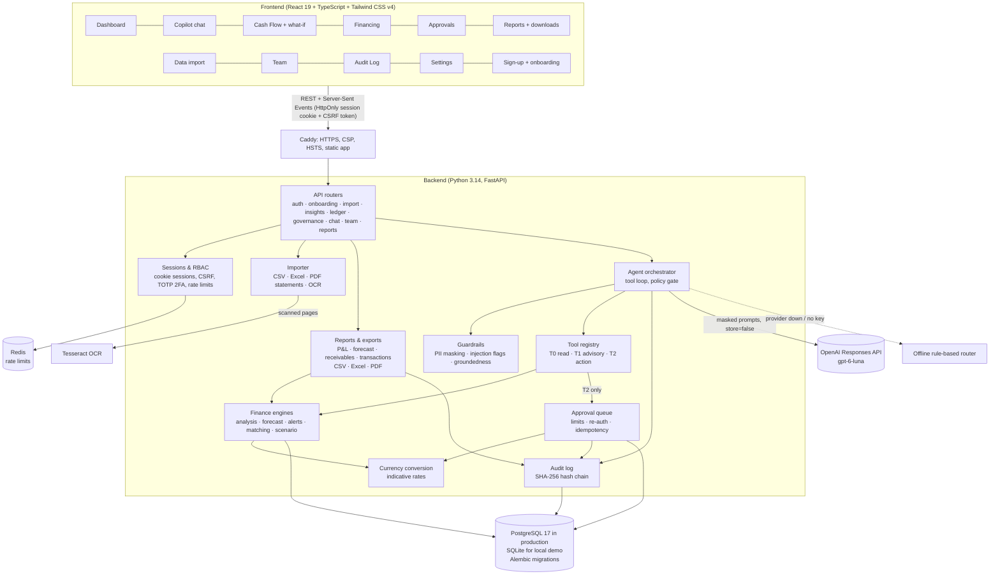

# SME Finance Copilot: Technical Documentation

**Competition:** 2026 Shenzhen International FinTech Competition (FinTechathon), WeBank International Track
**Topic E:** SME Finance Copilot (financing-option matching, cash-flow management with alerts, business financial analysis)
**Theme:** "AI as a Financial Participant": an AI agent that completes real financial tasks

Repository: https://github.com/mdfahaduddin/SME_Finance_Copilot

---

## 1. Summary

SME Finance Copilot is an AI agent for small-business owners. A business signs up, adds its bank accounts and imports its bank statements, invoices and bills. The agent then:

1. **Analyses the business.** It computes profitability, liquidity, collections, debt capacity, customer concentration and expense anomalies, and combines them into an explainable 0–100 health score.
2. **Forecasts cash flow and raises alerts.** It builds a 13-week forecast with an uncertainty band, warns before the balance drops below a safety buffer, and attaches a concrete suggested action to every alert.
3. **Matches financing.** It ranks lender products by real cost, fit, approval odds, affordability and speed, and explains why each excluded product is unavailable.
4. **Acts, under human control.** It drafts payment reminders, supplier deferral requests, scheduled payments and loan applications. Every action waits in an approval queue until an authorised person approves it.
5. **Works from real documents.** Bank statements are imported from PDF (including scanned statements read with on-server OCR), CSV or Excel. Every PDF row is reconciled against the printed running balance before it is saved.
6. **Works in the business's own currency.** Amounts, financing criteria, cash-flow scenarios and approval limits are shown and enforced in the business currency (USD, BDT, EUR, INR and more).
7. **Produces reports to share.** Profit and loss by month, the cash-flow forecast, aged receivables and filtered transactions, viewable on screen and downloadable as CSV or Excel, plus a two-page financial summary PDF for a lender or accountant.

**The design principle: "the LLM reasons, the engines calculate."** The language model chooses which tools to call and explains the results. Every number comes from deterministic, unit-tested Python engines. A groundedness check then verifies that each figure in the answer traces back to a tool result.

### Demo scenario
The local demo database holds **Lotus Bakery & Cafe Ltd.**: two locations, 14 staff, about $1.2M annual revenue and 18 months of synthetic but realistic history. The copilot should discover four problems on its own:
- **Cash squeeze in late November.** Payroll, a $12,500 bulk flour order and the owner's draw land in the same week, so the forecast low is **$2,993**, against a safety buffer of **$21,923**.
- **A worsening payer.** Riverside Hotel Group paid 32 days late on average over the year, and 44 days late recently.
- **An expense anomaly.** A $6,850 oven repair.
- **A planted prompt-injection memo.** An invoice memo tells "the AI assistant" to transfer $5,000. The agent must ignore it.

In production there is no demo data: businesses register and import their own statements.

---

## 2. Architecture



### 2.1 Components

| Layer | Module | Responsibility |
|---|---|---|
| API | `app/api/*.py` | 63 REST paths (68 operations), all scoped to the caller's business; chat streams Server-Sent Events |
| Auth | `app/auth.py`, `app/security.py` | Server-side sessions (hashed tokens) in an HttpOnly cookie, signed CSRF tokens, bcrypt, TOTP two-factor (secrets encrypted with AES-GCM), password reset and invitations by email |
| Onboarding | `app/api/auth.py`, `app/api/onboarding.py` | Self-service registration, business profile, bank accounts, team invitations and roles |
| Import | `app/importer.py`, `app/pdf_statement.py`, `app/ocr.py` | CSV/Excel/PDF parsing, validation, de-duplication, categorisation, invoice-payment linking, statement reconciliation, OCR for scanned pages |
| Agent | `app/agent/orchestrator.py` | Tool-calling loop (max 8 steps), policy gate, audit, streaming events |
| | `app/agent/tools.py` | 15 tools with JSON schemas and permission tiers |
| | `app/agent/llm.py` | OpenAI Responses API client (streaming, `store=false`, encrypted reasoning replay); scripted test double |
| | `app/agent/pii.py` | PII masking/unmasking around every LLM call |
| | `app/agent/guardrails.py` | Input limits, injection heuristics, groundedness check, disclaimers |
| | `app/agent/fallback.py` | Offline intent router + templated answers |
| Engines | `app/engines/*.py` | Deterministic finance calculations over pandas DataFrames |
| Reports | `app/engines/reports.py`, `app/reports_export.py`, `app/api/reports.py` | Period P&L, aged receivables, forecast and transaction reports; CSV, Excel and PDF output |
| Currency | `app/fx.py` | Indicative exchange rates (overridable with `FX_RATES`), conversion and formatting |
| Actions | `app/actions.py` | Tier-2 action specs, validation, approval queue, currency-aware safety limits, sandbox executors |
| Audit | `app/audit.py` | Append-only hash-chained log, verification, export |
| Data | `app/models.py`, `migrations/`, `seed/` | 18 tables; Alembic migrations; deterministic demo data and lender catalogue |
| Operations | `app/cli.py`, `docker-compose.yml`, `deploy/` | Configuration check, catalogue loading, daily pruning; Docker stack; backup and restore scripts |

### 2.2 Technology

| | Choice | Why |
|---|---|---|
| Backend | Python 3.14, FastAPI, Pydantic 2, SQLAlchemy 2.1, Alembic | Strict validation, automatic OpenAPI docs, versioned schema migrations |
| Analytics | pandas 3, numpy 2, statsmodels | Time-series and ratio analysis |
| Documents | pdfplumber, pypdfium2, Tesseract OCR, openpyxl, fpdf2 | Text PDFs, rendering scanned pages for OCR, Excel import and export, the PDF summary |
| LLM | OpenAI Responses API (`gpt-6-luna`, configurable) | Reasoning model with function calling |
| Database | PostgreSQL 17 (production), SQLite (local demo) | Production refuses to start on anything but PostgreSQL; the demo needs no database server |
| Rate limits | Redis (in-memory fallback for a single local process) | Limits shared across API workers |
| Frontend | React 19, TypeScript, Vite, **Tailwind CSS v4**, Recharts 3, lucide-react | Utility-first design system with light/dark tokens and lazy-loaded routes |
| Delivery | Docker Compose: Caddy 2 (automatic HTTPS), API, PostgreSQL, Redis, scheduler | One-server deployment with security headers and TLS by default |
| Tests / CI | pytest (236 backend tests), Vitest + React Testing Library (42 frontend tests), GitHub Actions | Tests, PostgreSQL migrations + smoke test, frontend build, dependency audit, Docker builds |

### 2.3 Data model

| Table | Purpose |
|---|---|
| `SmeBusiness`, `SmeUser` | Business profile (currency, credit score, collateral, onboarding status), users with roles and optional 2FA |
| `UserSession`, `AuthToken` | Server-side sessions (token hashes only); single-use password-reset and invitation tokens |
| `SmeBankAccount`, `SmeTransaction` | Bank accounts (last 4 digits only) and the transaction ledger |
| `SmeInvoice`, `SmeBill`, `SmeLoan` | Receivables, payables (incl. `ScheduledDate`), existing debt |
| `ImportBatch` | Every import: file name, counts, rejected rows, who and when |
| `FinProduct` | Lender catalogue (14 illustrative products, 6 product types), with the currency of its limits |
| `SmeAlert` | Alerts with fingerprint de-duplication and auto-resolution |
| `AgentActionRequest` | Approval queue: tool, validated params, amount, risk, status, idempotency key, expiry |
| `LoanApplication`, `SmeOutboxMessage` | Results of executed actions (prepared applications and emails) |
| `ChatSession`, `ChatMessage` | Private conversations (searchable, renamable, pinnable) with tool trace and groundedness metadata |
| `AuditLog` | Hash-chained audit trail |

---

## 3. Core algorithms

All engines are pure functions over a `Ledger` (DataFrames loaded for one business), which keeps them deterministic and testable.

### 3.1 Financial analysis (`engines/analysis.py`)

| Metric | Definition |
|---|---|
| Revenue, COGS, gross margin | Inflows in `Sales - *` categories; ingredients, packaging and inventory |
| Operating profit | Revenue − COGS − operating expenses (payroll, rent, utilities, insurance, software, marketing, maintenance, fees) |
| Net margin | (Operating profit − interest − taxes − owner compensation) / revenue |
| Cash cover | Total cash / average monthly outflows (last 90 days): months the business survives with zero revenue |
| Runway | Cash / net monthly burn (only when losing cash) |
| DSO / DPO | Open receivables (payables) / credit sales (purchases) per day, last 90 days |
| DSCR | (Operating profit − owner compensation) / annual debt service |
| Concentration | Largest customer's share of total and B2B revenue; Herfindahl index across B2B customers |
| Payment behaviour | Per customer: average days paid after due date, overall vs. last 3 invoices → *worsening / stable / improving* |
| Expense anomalies | Category-month spend > trailing-12-month mean + 2σ (and above a minimum). Categories paid several times a month are compared on average payment × typical count, so a month with an extra pay run is not flagged |

**Health score (0–100).** A weighted sum of transparent piecewise-linear sub-scores. Each sub-score maps a metric onto 0–100 between a "worst" and a "best" value:

| Component | Weight | 0 points at | 100 points at |
|---|---|---|---|
| Liquidity (cash cover) | 25% | 0 months | 3 months |
| Profitability (net margin) | 20% | −5% | 15% |
| Growth (90-day revenue YoY) | 15% | −10% | +20% |
| Collections (DSO) | 15% | 90 days | 30 days |
| Debt capacity (DSCR) | 15% | 1.0× | 2.0× |
| Revenue stability | 10% | top customer 50% / CV 0.4 | top customer 10% / CV 0.05 |

The UI shows each component's score, weight, contribution and explanation. For the demo business the score is 60 ("Fair"), and the weakest area is liquidity, at 0.6 months of cash cover. With less than 3 months of history the score is withheld rather than guessed, and growth and debt components say why they cannot be computed yet (e.g. "needs 12+ months of history").

### 3.2 13-week cash-flow forecast (`engines/forecast.py`)

The forecast is a hybrid model, chosen to be explainable and robust with limited history.

1. **Known items (deterministic)**
   - **Open invoices:** expected on *due date + that customer's recent average delay*. Invoices already later than expected move to next week and are flagged *at risk*, as is anything more than 30 days overdue.
   - **Open bills:** on their due date, or on their scheduled date once a payment is scheduled.
2. **Recurring items detected from the ledger**
   - For each (counterparty, category), the median interval between payments is classified as weekly, bi-weekly, monthly or bi-monthly. Irregular series (σ > 25% of the median) are rejected.
   - The pattern continues from the later of the last payment or the last *regular-sized* open bill, so a one-off bulk order cannot hide a weekly pattern.
   - Cost-of-goods items are scaled by the seasonal index.
   - Counterparties paid at most 4 times a year repeat last year's payments that fall in the horizon, unless an open bill already covers them.
3. **Statistical baseline**
   - **Retail sales:** the level comes from simple exponential smoothing (statsmodels) over the last 26 weeks. Each future week is multiplied by a seasonal index: the ratio of sales in the same week last year to the 4 weeks before the reference date last year.
   - **New B2B invoices:** each active customer's 6-month weekly billing rate, collected from *today + 30-day terms + their usual delay*.
4. **Uncertainty**
   - Weekly variance comes from the residuals of retail sales against the smoothed level, plus ±25% on projected new B2B billing. It accumulates over the horizon.
   - **P10/P90** = closing balance ± 1.2816σ. P10 also subtracts at-risk receivables expected by that week.

**Output:** for each week, the opening, inflows and outflows (by category), net and closing balance, the P10/P90 band, and the four largest driving items. The summary gives the lowest point, the first week below the safety buffer (default: one week of average outgoings), the first negative week, the shortfall amount, at-risk receivables, and every assumption in plain language. The opening balance is the operating cash: checking accounts, or all accounts for a business that only has savings accounts.

### 3.3 Alerts (`engines/alerts.py`)

| Rule | Severity |
|---|---|
| Projected balance < 0 | critical |
| Projected balance < safety buffer | high |
| P10 (downside) negative while the base case is not | medium |
| Customer owes invoices > 30 days overdue (grouped by customer) | medium / high if > 60 days |
| Customer's payment delay worsening by > 7 days | medium |
| Expense anomaly (recent / older) | medium / low |
| Customer concentration > 30% of total / of B2B revenue | medium / low |
| Runway < 3 months (when burning cash) | high |
| Next week's balance below the loan payment | critical |

Every alert explains *why* it fired, with the figures (in the business currency) and drivers, and gives a *suggested action*. Alerts are upserted by fingerprint, rewritten on each refresh, and auto-resolve when their condition clears.

### 3.4 Financing matcher (`engines/matching.py`)

1. **Size the need.** Either explicit (amount, purpose, term, deadline), or derived from the forecast: shortfall × 1.1 (rounded up), purpose = bridge, term from the weeks below the buffer.
2. **Convert the lender's limits.** Each product's amount and revenue limits are set in the product's currency and converted into the business currency at an indicative rate (section 3.7), so a BDT business is compared against BDT figures.
3. **Hard eligibility rules.** Amount range, minimum and maximum revenue, years trading, credit score, collateral, industry inclusions and exclusions, and purpose. *Every failed rule is reported.* A product that fails only on its maximum amount is shown as able to fund part of the need.
4. **APR estimate.** The business is placed within the lender's APR range by credit score: 760+ gets the best rate, 580 or below the worst. Without a credit score, a conservative 640 is assumed and disclosed.
5. **Cost model.**
   - Term and equipment loans amortise (standard annuity formula).
   - Credit lines, invoice finance and cash advances charge interest on the drawn amount over the term. Revolving lines are costed for the months actually needed.
   - Origination fees are added and spread into an effective APR.
6. **Weighted score (0–100):**

| Factor | Weight | Basis |
|---|---|---|
| Cost | 35% | Effective APR: 0% → 100 points, 40% or more → 0 |
| Fit to purpose | 20% | Product type × purpose matrix, with penalties for term mismatch or insufficient receivables |
| Approval likelihood | 20% | Average margin above the credit, revenue and years-trading minimums (grants capped, because they are competitive) |
| Affordability | 15% | DSCR after adding the new payment: 1.0× → 0, 2.0× → 100; a warning below 1.25× |
| Speed | 10% | Days to funds; 0 if slower than the stated deadline |

**Output:** ranked offers with monthly payment, total cost, DSCR after borrowing, reasons, watch-outs, the ineligible products with reasons, the conversion rate used, and a regulatory disclaimer.

### 3.5 What-if scenarios (`engines/scenario.py`)

The forecast is built as a list of projected items, so a scenario edits those items and re-aggregates them using the same code path. Changes can be combined: a customer pays late, a customer is lost, sales change by ±%, a one-off expense, a new loan (funding plus repayments), a supplier bill is deferred, a new hire. The result compares the baseline with the scenario (lowest balance, ending balance, weeks below the buffer) and gives a verdict: *comfortable*, *tight* or *not affordable as-is*.

### 3.6 Statement import (`importer.py`, `pdf_statement.py`, `ocr.py`)

**CSV and Excel.** Header aliases are recognised (e.g. *Posting Date*, *Details*, *Credit/Debit*), dates in many formats (an explicit format is asked for when ambiguous, e.g. 03/09/2026), amounts with currency symbols, thousands separators and parentheses. Each row is validated; rejected rows are listed with the reason. Rows are de-duplicated with a content fingerprint, so re-importing the same file adds nothing. Categories are guessed from the description (payroll, rent, supplier, card sales, local transfer formats such as NPSB/BEFTN). Incoming payments that mention an open invoice number mark that invoice as paid.

**PDF bank statements** (text or scanned):
1. **Layout.** Words are grouped into lines; the column header is found (with fuzzy matching for OCR misreads) and each money column's span is learnt from its alignment. Wrapped descriptions are joined. Password-protected PDFs are opened with the user's password.
2. **Balances.** Opening and closing balances ("brought forward", "closing balance") are recognised, including newest-first statements.
3. **Reconciliation.** Each row is checked against the printed running balance: previous balance ± amount must equal the row's balance. A misread balance or a misread opening balance is distinguished from a misread amount. Totals are checked too: opening + all rows = closing.
4. **Scanned pages.** Pages without text are rendered (300 dpi, capped in pixels), cleaned (median filter, Otsu binarisation, inverted dark header bands, deskew) and read with Tesseract. **Only rows the running balance confirms are imported from OCR**, and a scan where fewer than 60% of rows are confirmed is refused rather than guessed. OCR runs with a per-process concurrency limit, a page limit and a timeout per page.
5. **Preview first.** Every import can be checked as a dry run: rows, categories, reconciliation result and warnings are shown before anything is saved.

### 3.7 Currencies (`fx.py`)

Each business has a currency. Every amount is stored and computed in it. Where a figure is set in another currency, it is converted at an indicative rate (units per 1 USD, built in and overridable with the `FX_RATES` setting):
- **Financing:** lender limits (amount range, revenue bounds), with the rate disclosed in the results.
- **Approval limits:** the password re-confirmation threshold and payment caps, defined once in USD and converted, then rounded to two significant figures (e.g. $5,000 → BDT 610,000). A currency without a rate keeps the USD figures, which is stricter, never looser.
- **Text:** alerts, scenario descriptions, approval summaries, emails and copilot answers use the business currency.

### 3.8 Reports (`engines/reports.py`, `reports_export.py`)

Reports reuse the analysis engine's definitions, so a report never disagrees with the dashboard or the copilot (a test checks the P&L against the analysis engine over the same 365 days).

| Report | Content | Filters |
|---|---|---|
| Profit and loss | One column per calendar month plus a total: revenue by sales category, cost of goods, gross profit, operating expenses by category, operating profit, estimated interest, taxes, owner compensation, net profit; partial months are marked | Period (presets or custom dates, up to 3 years) |
| Cash-flow forecast | The 13 weeks: opening, money in and out, net, closing, P10/P90, weeks below the safety buffer | – |
| Aged receivables | Open invoices by customer in current / 1–30 / 31–60 / 61–90 / 90+ day buckets, oldest first, with average collection days | – |
| Transactions | Ledger rows with account (last 4 digits only), description, payee, category and signed amount, with totals | Period, account, category, direction, text search |

Every report is shown on screen and downloads as **CSV** (UTF-8 with a byte-order mark for Excel) or **Excel** (header styling, number formats, frozen header, subtotal and total rows in bold). Text that would start a spreadsheet formula (`= + - @`) is neutralised in both. The **financial summary PDF** is two A4 pages: key figures, the 12-month P&L with a monthly revenue chart, the health score breakdown, the cash position and forecast chart with the safety buffer, receivables aging and most overdue customers, existing debt, and a method note stating that the figures are unaudited management figures and not financial advice. Downloads are audited (`report.downloaded`).

---

## 4. The AI agent

### 4.1 Tool loop (`agent/orchestrator.py`)

For each user message:
1. **Input guardrails.** Control characters are stripped, the message length is limited, and prompt-injection patterns are flagged in the audit log.
2. **Masked context.** The system prompt (business, date, currency, role-specific rules), recent messages and the new message are sent with PII replaced by tokens.
3. **Loop of up to 8 steps.**
   - The model is called through the **OpenAI Responses API**, streaming, with only the tools allowed for the user's role.
   - Each tool call passes the **policy gate**: the tool exists, its tier is allowed for the role, and the per-turn action cap (3) is not exceeded.
   - Each call is executed and audited, and its masked JSON result is returned to the model.
   - With `store=false`, the model's encrypted reasoning items are replayed between steps, so reasoning continues across tool calls without the provider retaining data.
4. **Final answer.** The answer is unmasked for display, the **groundedness check** runs, a disclaimer is added for financing advice, and the answer is saved with its tool trace and metadata, and audited.
5. **Fallback.** If no key is configured, or the provider fails mid-turn, the offline rule-based router answers through the *same* tool executor, so policy and audit still apply.

**Events streamed to the UI:** `status`, `delta` and `reset`; `tool_call` / `tool_result` (live tool timeline); `approval` (inline approval card); `final` (tool trace, groundedness, mode, PII count, approval IDs).

### 4.2 Tools and permission tiers (`agent/tools.py`)

| Tier | Tools | Effect |
|---|---|---|
| **T0 Read** | `get_business_profile`, `get_account_balances`, `get_invoices`, `get_bills`, `get_transactions`, `get_alerts` | Read the business's data |
| **T1 Advisory** | `analyze_financials`, `forecast_cashflow`, `match_financing`, `run_scenario`, `explain_metric` | Compute and recommend; no side effects |
| **T2 Action** | `request_payment_reminder`, `request_schedule_payment`, `request_bill_deferral`, `request_loan_application` | **Only create a pending approval request.** The tool result tells the model that nothing has happened yet |

Roles map to tiers on the server. Viewers only *see* T0 and T1 tools; owners and accountants get all three. Third-party free text in tool results, such as invoice memos, is wrapped as `untrusted_text`, and a `security_warning` is attached when that text contains instructions.

### 4.3 Groundedness check (`agent/guardrails.py`)

Every monetary figure, percentage and large number in the final answer is parsed, including forms like "$45k", "$1.2M" and "BDT 5,490,000". Each one is compared against every number in that turn's tool results and in the user's message. The tolerance is the larger of 1 unit or 0.6%, and percentages are also matched against their ratio form (3.9% ↔ 0.039). Week numbers and years are ignored. The result ("6/6 figures verified", or a list of unverified figures) is shown on every answer and written to the audit log.

### 4.4 Offline mode (`agent/fallback.py`)

A keyword intent router covers the core flows: cash forecast, health overview, receivables, bills, alerts, financing (including sizing from the forecast), affordability, customer scenarios ("my biggest customer pays late") and payment reminders. Answers come from templates filled with tool results, in the business currency. This makes the demo, the test suite and judges' local runs independent of an API key.

---

## 5. Security design (summary)

The full threat model and known risks are in [SECURITY_SELF_ASSESSMENT.md](SECURITY_SELF_ASSESSMENT.md).

| Control | Implementation |
|---|---|
| Authentication | Server-side sessions (only token hashes stored) in an HttpOnly, SameSite cookie; 60 min idle / 12 h absolute; bcrypt; optional TOTP two-factor (secrets encrypted with AES-GCM); password reset and invitations with single-use tokens; all sessions revoked on password change; identical errors for unknown users and wrong passwords |
| CSRF | Every state-changing cookie request must send `X-CSRF-Token` equal to an HMAC of the session token |
| Abuse protection | Rate limits (Redis-backed): sign-in and 2FA 5/min, registration 5/h, recovery 5/15 min, chat and actions 20/min, imports 10/5 min |
| Authorisation | Roles (owner / accountant / viewer) enforced on every route; every query scoped to the session's business |
| Human-in-the-loop | All external or financial effects go through `AgentActionRequest`. The agent has no approval tool; approval happens only through authenticated calls by an allowed role |
| Step-up authentication | Approving an action at or above the threshold ($5,000 or the business-currency equivalent) requires the approver's password; failures are audited |
| Limits | Scheduled payments capped per payment and per day (converted into the business currency); up to 3 action requests and 8 steps per agent turn |
| Integrity | Pydantic schemas with `extra="forbid"`; amounts read from the referenced records (never from the client or the model); idempotency keys; approved → executed only once; 24-hour expiry |
| Imports | 5 MB upload limit (256 KB for other requests), type checks, page and pixel caps, OCR timeouts and concurrency limits, unbalanced OCR rows never imported |
| LLM privacy | Names, emails, account and phone numbers masked before the provider; `store=false`; a pseudonymous `safety_identifier` |
| Prompt injection | Untrusted text labelled and flagged; no money-moving tool exists; T2 actions still need a human; injection attempts audited |
| Hallucination | Engines compute every figure; groundedness check on every answer |
| Audit | Append-only SHA-256 hash chain; parameters stored only as hashes (no customer PII); `/audit/verify` detects edits, deletions and reordering; export includes the proof |
| Web hardening | Caddy: HTTPS with HSTS, CSP (`script-src 'self'`), `nosniff`, `DENY` framing, `no-referrer`; account numbers stored as last 4 digits; CORS restricted to the app origin; API docs disabled in production; the app refuses to start with weak production configuration |

---

## 6. API reference

Interactive OpenAPI docs (development only): `http://localhost:8000/docs`.

| Area | Endpoints |
|---|---|
| System | `GET /api/health`, `GET /api/ready`, `GET /api/policy` |
| Auth | `POST /api/auth/register`, `/login`, `/logout`, `/mfa/verify`, `/mfa/setup`, `/mfa/enable`, `/mfa/disable`, `/password/change`, `/password/forgot`, `/password/reset`, `/sessions/revoke-others`, `/invite/accept`; `GET /api/auth/me`, `/sessions`, `/industries`, `/invite/{token}` |
| Business and team | `GET/PUT /api/business/profile`, `POST /api/business/accounts`, `PUT /api/business/accounts/{id}`, `GET /api/onboarding/status`, `POST /api/onboarding/complete`, `GET /api/team`, `POST /api/team/invites`, `DELETE /api/team/invites/{id}`, `PATCH /api/team/members/{id}` |
| Import | `GET /api/import/options`, `GET /api/import/templates/{kind}.csv`, `POST /api/import/{transactions\|invoices\|bills}`, `GET /api/import/history` |
| Insights | `GET /api/dashboard/summary`, `GET /api/analysis`, `GET /api/cashflow/forecast`, `POST /api/scenarios/run`, `GET /api/alerts`, `POST /api/alerts/{id}/ack` |
| Financing | `GET /api/financing/products`, `POST /api/financing/match` |
| Ledger (read-only) | `GET /api/ledger/accounts`, `/transactions`, `/invoices`, `/bills`, `/loan-applications`, `/outbox` |
| Approvals | `GET/POST /api/approvals`, `GET /api/approvals/{id}`, `GET /api/approvals/actions`, `POST /api/approvals/{id}/approve`, `POST /api/approvals/{id}/reject` |
| Audit (staff) | `GET /api/audit`, `GET /api/audit/verify`, `GET /api/audit/export?format=json\|csv` |
| Reports | `GET /api/reports/options`, `GET /api/reports/{pnl\|forecast\|receivables\|transactions}?format=json\|csv\|xlsx` (with `start`, `end`, `accountId`, `category`, `direction`, `q` where they apply), `GET /api/reports/summary.pdf` |
| Chat | `GET/POST /api/chat/sessions` (`?q=` searches titles and messages), `PATCH /api/chat/sessions/{id}` (rename, pin), `DELETE /api/chat/sessions/{id}`, `GET /api/chat/sessions/{id}/messages`, `POST /api/chat/sessions/{id}/messages` (SSE stream, or `?stream=false` for JSON) |

---

## 7. Frontend

React 19 + TypeScript, styled entirely with **Tailwind CSS v4** utilities. There's no UI kit.
- **Design tokens.** Colours are semantic tokens (surface, ink, muted, brand, status, chart) in `src/index.css`. Dark mode redefines those tokens, so components never branch on theme. Brand-coloured scrollbars and toast notifications for every completed action.
- **Reusable components:** Card, Badge, Button, form fields (with icons, password visibility and strength meter), StatTile, Skeleton, EmptyState, PageHeader, AlertItem, charts, ToolTrace, ApprovalCard, MessageBubble.
- **Charts.** The categorical colours are a validated palette, checked for colour-vision-deficiency separation and contrast on both themes. The forecast chart shows the P10–P90 band, the safety buffer as a labelled threshold and a direct label on the low point.
- **Pages:**
  - Sign in (with two-factor step), registration (two steps), password reset, team invitation
  - Onboarding: bank accounts, then statement import
  - Dashboard: cash, KPIs, health gauge, forecast, monthly inflows/outflows, alerts, quick actions
  - Copilot: streaming chat, live tool timeline, inline approval cards, "figures verified" and "PII hidden" badges; conversation search, rename, pin and delete
  - Cash Flow: forecast, weekly drivers, combinable what-if simulator
  - Financing: ranked offers with score breakdown, ineligible reasons, conversion note, request application
  - Reports: profit and loss, cash-flow forecast, aged receivables and transactions with period presets and filters; CSV, Excel and PDF downloads
  - Approvals, Data (accounts, imports with preview and reconciliation summary), Team, Audit Log, Settings (profile, security, policy, permissions by role, tool list)
- **Other details.** Lazy-loaded pages; responsive down to 375 px; collapsible sidebar (Ctrl/⌘+B); the session token is never readable by JavaScript (HttpOnly cookie).

---

## 8. Testing

```bash
cd backend && pytest        # 236 tests, about 2 minutes, no network or API key required
```

| Suite | Tests | Covers |
|---|---|---|
| `test_seed.py` | 10 | Deterministic generation, ledger reconciles to balances, story points present |
| `test_analysis.py` | 9 | Exact P&L figures, ageing/DSO, runway logic, anomaly detection, payment trends, health score bounds |
| `test_forecast.py` | 9 | Invoice timing from customer delays, at-risk flags, bill timing, recurring detection, annual items, the seeded squeeze |
| `test_alerts_matching_scenario.py` | 15 | Alert rules and de-duplication, amortisation maths, eligibility reasons, partial funding, scenario deltas |
| `test_api.py` | 29 | Authentication on every route, validation, masking, security headers, body limits, policy endpoint |
| `test_auth.py` | 20 | Cookie flags, CSRF, idle and absolute expiry, revocation, registration, password reset, invitations, TOTP two-factor |
| `test_security.py` | 15 | RBAC, approval flows, password re-confirmation, double execution, idempotency, expiry, payment limits, parameter injection, login rate limit, audit tamper detection, no PII in the audit log |
| `test_agent.py` | 30 | PII masking, guardrails, groundedness, scripted-LLM tool loop, injection-obeying model blocked, viewer tool restriction, action cap, provider failure fallback, offline router, SSE API, conversation search, rename, pin, delete and privacy |
| `test_import.py` | 33 | CSV/Excel parsing, date and amount formats, validation, de-duplication, invoice linking, permissions, business isolation |
| `test_pdf_statement.py` | 22 | Statement layouts, wrapped text, CR/DR, reconciliation of misread rows, passwords, scanned-file handling, end-to-end import |
| `test_ocr.py` | 22 | Image cleaning, deskew, OCR reading and the balance-confirmed import policy (7 need Tesseract; they run in CI and Docker) |
| `test_fx.py` | 7 | Rates and overrides, converted financing limits, identical eligibility across currencies, BDT approval limits, scenarios, alerts and answers |
| `test_reports.py` | 11 | P&L agrees with the analysis engine, monthly columns add up, aged receivables reconcile, filters, CSV/Excel/PDF content, formula-injection protection, audit, isolation and currency, copilot pointing to Reports |
| `test_profile.py` | 4 | Business profile editing and validation |

**Frontend** (`cd frontend && npm test`, 42 tests, Vitest with React Testing Library in a simulated browser; also run in CI):

| Suite | Tests | Covers |
|---|---|---|
| `pages/Login.test.tsx` | 4 | Sign-in, server errors shown, the two-factor step (digits only, 6 required), recovery and registration links |
| `components/chat/ConversationList.test.tsx` | 8 | Pinned-first grouping, opening and new chat, server search with highlighted matches, empty results, pin/unpin, rename (Enter tidies, Escape cancels), delete with confirmation, actions hidden while answering |
| `components/layout/Sidebar.test.tsx` | 3 | Every page listed with the current one marked, pending-approval count, collapse and its memory, Ctrl+B |
| `components/ui/Field.test.tsx` | 7 | Labels, errors replacing hints, show/hide password, form errors as alerts, the password strength meter |
| `lib/toast.test.tsx` | 5 | Success and error toasts, auto-dismiss timing, at most four, manual dismiss |
| `lib/download.test.ts` | 3 | Server-chosen file names, fallback names, server error messages |
| `pages/Reports.test.ts` | 8 | Period presets (including across year boundaries) and query strings |
| `lib/format.test.ts` | 4 | Money in the business currency (USD, BDT, EUR, compact) and percentages |

The agent tests use a scripted LLM, so they're deterministic. `scripts/generate_evidence.py` runs the main flows end to end against the live model (see [EXECUTION_EVIDENCE.md](EXECUTION_EVIDENCE.md)).

---

## 9. Deployment

- **Local demo:** see the [README](../README.md#run-the-demo-locally): SQLite, demo data, two terminals, no API key needed.
- **Production:** see [DEPLOYMENT.md](DEPLOYMENT.md): Docker Compose on one Linux server with Caddy (automatic HTTPS), the API (applies migrations on start), PostgreSQL 17, Redis and a scheduler; daily backups with `deploy/backup.sh`. CI runs the tests, PostgreSQL migrations with a smoke test, the frontend build, a dependency audit and the Docker builds on every push.
